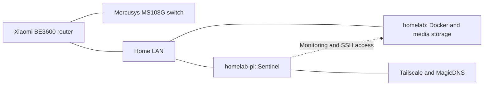
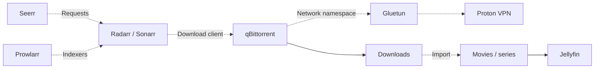

# HomeLAB

Personal self-hosted infrastructure and learning project.

The goal is to build a reproducible, documented and maintainable home infrastructure while learning Linux, Docker, networking, storage, automation and operations.

Deployment survey: **2026-11-13**. The owner ran read-only commands on both nodes; the results were reviewed against the repository. Hardware details for the main host were confirmed unchanged by the owner. A running container or an HTTP response does not establish that an entire application workflow passes.

Dashboard deployment and review: **2026-11-18**. Homarr runs on the main host with a dedicated Tailscale HTTPS endpoint, eight HomeLAB application tiles and six integrations. The [dashboard runbook](docs/dashboard/homarr.md) records the observed board, verification results and remaining manual checks.

- [Media architecture and storage](docs/media/overview.md)
- [Homarr dashboard and private access](docs/dashboard/homarr.md)
- [Sentinel runtime and source layout](docs/monitoring/sentinel-overview.md)
- [Sentinel access and security](docs/monitoring/security.md)
- [Documentation index](docs/README.md)

---

## Current Platform

### Main HomeLAB

- Debian 13
- Docker Engine
- Docker Compose
- UFW
- Toshiba Satellite L750D
- AMD A6-3400M
- 8 GB RAM
- 120 GB SSD
- 500 GB HDD

### Sentinel Node

- Raspberry Pi 3 Model B Rev 1.2
- Debian 13
- ARM64 / Cortex-A53
- ~1 GB RAM
- Ethernet: `192.168.31.11`
- Tailscale enabled
- Sentinel monitoring project under development

### Network

The owner confirmed a Xiaomi BE3600 router with a Mercusys MS108G switch behind it. Router configuration, port forwarding and the exact switch-port layout were not inspected.



The Pi has active Ethernet and Wi-Fi connections; Ethernet had the preferred default route during the November 13 survey. On November 18, the owner's Tailscale client reported the Pi online and advertising `192.168.31.0/24`. The owner confirmed that Homarr and its Jellyfin link open on mobile data with Tailscale enabled; other remote application links were not tested. Homarr uses a separate userspace Tailscale container on the main host for private HTTPS at `homarr.tail39df36.ts.net`; enrollment, certificate verification and application-data checks are recorded in the [dashboard runbook](docs/dashboard/homarr.md). No host-wide Tailscale installation or exit-node change is part of this deployment.

---

## Current Services

| Service | Purpose | Port |
|---|---|---:|
| Jellyfin | Media playback | 8096 |
| qBittorrent | Download client | 8081 |
| Gluetun | Proton VPN gateway for qBittorrent | internal |
| qbit-port-sync | Proton forwarded-port synchronization | internal |
| Radarr | Movie automation | 7878 |
| Sonarr | Series automation | 8989 |
| Seerr | Request management | 5055 |
| Prowlarr | Indexer management | 9696 |
| Portainer | Docker management | 9443 |
| Nginx | Web / learning service | 8080 |
| Homarr | Private HomeLAB dashboard, separate Tailscale HTTPS endpoint | no host port |

Seerr was running and returned an HTTP redirect from the Pi. Its application integrations were not exercised during this survey.

---

## Media Architecture



The media stack is configured to route qBittorrent torrent traffic through Proton VPN.

Radarr, Sonarr, Prowlarr and Jellyfin remain on the normal HomeLAB network.

This is the documented routing design. The survey inspected container status and selected network/mount metadata, without testing the VPN exit address or failure behavior. Seerr adds request management ahead of Radarr and Sonarr; the full request-to-playback flow remains a separate test.

---

## Media Storage

```text
/srv/media/
├── downloads/
│   ├── complete/
│   └── incomplete/
├── movies/
└── series/
```

Radarr and Sonarr use hardlinks where possible so downloaded media can remain available for seeding without consuming duplicate disk space.

qBittorrent, Radarr and Sonarr mount `/srv/media` at `/data`. Jellyfin has separate read-only mounts for the movie and series libraries. Current hardlink identity was not retested; earlier verification is recorded in the [hardlink notes](docs/media/hardlinks.md).

---

## Sentinel

The Raspberry Pi is being developed as an independent monitoring, diagnostics and recovery node.

Target flow:

```text
check
  ↓
confirm
  ↓
diagnose
  ↓
safe recovery
  ↓
verify
  ↓
notify
```

Observed runtime:

- `sentinel.timer` is active and invokes `sentinel.service` on a two-minute schedule.
- The inspected service run exited with status zero. The imported runner deliberately returns zero after recording either `OK` or `DEGRADED`; individual check outcomes were not read from its state file.
- The service runs as the Pi's administrative account. The current privilege model is described in the [security notes](docs/monitoring/security.md).
- A current status file, incident log and Telegram environment file exist. Notification delivery was not tested.

Implemented checks and access identified in the reviewed source:

- HomeLAB ping check
- SSH connectivity check
- HTTP service checks
- disk/memory thresholds, container state and saved-port/listener comparisons
- Dedicated `sentinel` account on HomeLAB
- Diagnostic sudo commands plus an explicitly permitted `vpn-stack` recovery helper

The source implements Telegram notifications on status transitions. Delivery was not tested, and the existing error handling has a credential-disclosure risk described in the security notes.

Further verification and follow-up:

- HTTP status interpretation, response parsing and Seerr monitoring coverage
- actual VPN exit routing and external port reachability
- recovery limits, failure confirmation and verification after recovery
- Telegram delivery and incident-history behavior
- log rotation and bounded local storage

---

## Configuration Sources

| Area | Repository source | Observed runtime source |
|---|---|---|
| Media services, including Seerr | [Media Compose](compose/media/compose.yaml) | `/srv/homelab/compose/media/compose.yaml` |
| Jellyfin | [Jellyfin Compose](compose/jellyfin/compose.yaml) | `/srv/homelab/compose/jellyfin/compose.yaml` |
| Nginx | [Nginx Compose](compose/nginx/compose.yaml) | `/srv/homelab/compose/nginx/compose.yaml` |
| Homarr | [Homarr Compose](compose/homarr/compose.yaml), [Serve](compose/homarr/tailscale/serve.json) | `/srv/homelab/compose/homarr`, separate appdata and Tailscale identity |
| Portainer | [Existing definition](compose/portainer/compose.yaml) | No Compose source label; deployment origin remains unverified |
| Port synchronization | [Script](scripts/media/update-qbit-port.sh) | Existing script mounted from ignored runtime `appdata` |
| Sentinel | [Runner](sentinel/src/runner.py), [dependencies](sentinel/requirements.txt), [units](sentinel/systemd/sentinel.service) | `/opt/sentinel` on the Pi, with configuration under `/etc/sentinel` |
| Main-host diagnostics and recovery | [Status helper](scripts/sentinel/sentinel-media-status), [recovery helper](scripts/sentinel/sentinel-recover-media) | `/usr/local/sbin` on the main host |

The imported source paths do not replace the deployed paths automatically. This collection records the current implementation, including deployment-specific settings and known limitations; it is not an automated installer.

The separate `compose/qbittorrent/compose.yaml` and the tracked pre-migration media snapshot are historical configuration sources, not the active media project's source identified during this survey. Do not start them alongside the active media stack without reviewing their purpose and conflicts.

## Runtime Layout

```text
/srv/homelab
├── appdata/
├── compose/
│   ├── jellyfin/
│   ├── media/
│   ├── nginx/
│   └── portainer/
├── docs/
│   ├── media/
│   └── monitoring/
└── web/
```

---

## Git Policy

Git stores:

- infrastructure configuration
- Docker Compose definitions
- scripts
- documentation

Git does not store:

- runtime application data
- logs
- credentials
- API keys
- VPN private keys
- generated caches
- new local rollback copies

The existing tracked pre-migration Compose snapshot is retained as historical material. It is not the active media project's source.

---

## Documentation

Detailed technical documentation is maintained under:

```text
docs/
```

The documentation is part of the implementation process and should follow the real deployed system closely enough that the environment can be understood and rebuilt without relying on memory.

## Verification and Deferred Work

The Pi received HTTP responses from Jellyfin, qBittorrent, Radarr, Sonarr, Prowlarr and Seerr on 2026-11-13. Redirects were not followed. Docker reported Jellyfin and Gluetun as healthy. These observations do not replace application, VPN, recovery or notification tests.

Backup infrastructure, DNS filtering and automated migration to replacement hardware are deferred. No HomeLAB application restore test was established by this survey; the presence of a package-database backup timer or a local configuration copy is not evidence of an application backup.

Known follow-up areas are the Docker/UFW access boundary, Sentinel privileges and helper behavior, storage capacity monitoring, and versioned deployment/restore procedures. This repository refresh does not deploy changes to either node.
