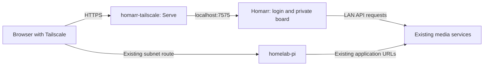

# Homarr dashboard

## Layout and access

Homarr has its own Compose project on the main HomeLAB host. The existing media, Jellyfin, Nginx and Portainer deployments keep their own lifecycle.



- Homarr image: `ghcr.io/homarr-labs/homarr:v2.13.1`.
- Tailscale image: `ghcr.io/tailscale/tailscale:v1.104.7`.
- Compose: `/srv/homelab/compose/homarr/compose.yaml`.
- Serve configuration: `/srv/homelab/compose/homarr/tailscale/serve.json`.
- Homarr database and configuration: `/srv/homelab/appdata/homarr`.
- Tailscale identity: `/srv/homelab/appdata/homarr-tailscale`.
- Encryption key: server-only `/srv/homelab/compose/homarr/.env`, mode `600`.

The Tailscale container uses userspace networking without `/dev/net/tun` or `NET_ADMIN`. Homarr shares its Docker network namespace. No host port or Docker socket is published or mounted. Tailscale Serve forwards HTTPS to Homarr on their shared loopback interface. Funnel is explicitly disabled.

The Homarr node must join the owner's tailnet, `ayashirozolesz.github`. Its final HTTPS name is obtained from `tailscale status` after login. Tailnet access rules still apply. Keep Homarr authentication enabled and the board private. Logging into Tailscale does not replace the Homarr account.

The Pi advertises `192.168.31.0/24`. This supplies access to existing application links. The Homarr HTTPS endpoint does not change the existing applications' HTTP connections or their authentication. The Pi-to-server segment of an HTTP application link is still HTTP.

## First deployment

Create the two appdata directories on the server, accessible only to their owner, and deploy the Compose and Serve files at the paths above. The Tailscale state directory must be owned by UID/GID `0:0`, mode `700`: its root process has all capabilities dropped and cannot access another user's mode-700 directory. The initial deployment exposed this ownership mismatch before login; correcting the owner resolved the state-store error. A one-time container with only `CHOWN` can set that owner without granting extra capabilities to the running service:

```sh
install -d -m 700 /srv/homelab/appdata/homarr /srv/homelab/appdata/homarr-tailscale
docker run --rm --network none --cap-drop ALL --cap-add CHOWN \
  --security-opt no-new-privileges:true \
  --mount type=bind,src=/srv/homelab/appdata/homarr-tailscale,dst=/state \
  --entrypoint chown ghcr.io/tailscale/tailscale:v1.104.7 0:0 /state
```

Keep secrets and runtime data out of Git. Before first startup, create the encryption key once:

```sh
cd /srv/homelab/compose/homarr
test ! -e .env && (
  umask 077
  { printf 'SECRET_ENCRYPTION_KEY='; openssl rand -hex 32; } > .env
)
docker compose config --quiet
docker compose pull
docker compose up -d
```

An existing `.env` must be retained. Changing the key prevents decryption of existing integration credentials. Do not paste expanded `docker compose config`, environment variables, database contents or authentication URLs into public logs.

With no stored Tailscale identity, complete the container's browser-based login in the owner's account. `TS_BOOT_TIMEOUT=10m` allows time for this initial interaction: the image's default 60-second boot timeout caused restarts and stale login URLs during the first enrollment attempt. Use the current container's authentication URL, not an older terminal window. Enable HTTPS certificates in the tailnet if Serve requests it. Do not enable Funnel. The entire `tailscale` configuration directory is mounted so Serve can detect configuration updates.

After HTTPS is available, complete Homarr onboarding in the browser. Set a unique administrator password, create a private HomeLAB board and enter integration credentials directly in Homarr. Do not store credentials in the tracked Compose or this document.

## Applications and integrations

The private board is named `dashboard` and opens at [the Homarr dashboard](https://homarr.tail39df36.ts.net/boards/dashboard). Onboarding is complete. The November 18 review found six configured integrations and eight HomeLAB application tiles. All six integrations store API-key credentials in Homarr; no credential values are included in this repository.

Integration URLs are called by the Homarr container. Application URLs are opened directly by the user's browser and require LAN access or the Pi's accepted subnet route.

| Application | Application / integration base URL | Configured dashboard use |
|---|---|---|
| Jellyfin | `http://192.168.31.10:8096` | App tile and Jellyfin integration |
| Seerr | `http://192.168.31.10:5055` | App tile, request list and request statistics |
| Sonarr | `http://192.168.31.10:8989` | App tile, calendar and media data |
| Radarr | `http://192.168.31.10:7878` | App tile, calendar and media data |
| qBittorrent | `http://192.168.31.10:8081` | App tile and download data |
| Prowlarr | `http://192.168.31.10:9696` | App tile and indexer-status integration |
| Portainer | `https://192.168.31.10:9443` | App tile; existing certificate policy applies |
| Nginx | `http://192.168.31.10:8080` | App tile |

qBittorrent shares Gluetun's network namespace; Gluetun publishes port `8081`. It does not have an independent Docker network endpoint. The LAN URL avoids coupling the Homarr project to the existing media network.

The configured request integration is `Seerr`, not the legacy Jellyseerr entry. Sonarr, Radarr, Prowlarr and Seerr expose their API key under their application settings. Jellyfin also has a saved API-key credential. qBittorrent 5.2.3 supports API-key authentication: Options → Web UI → API Key; the installed Homarr integration uses that key. Existing WebUI username/password authentication is a separate mechanism. Do not rotate an existing key merely to copy it into Homarr, because rotation invalidates clients using the old key.

### Board contents

The board has one `Home` tab with 24 items: 12 app tiles and 12 other widgets. Eight tiles open the HomeLAB services above; the four remaining starter tiles link to Homarr documentation, GitHub, translations and project support. The Bookmarks widget retains the same starter links.

The other widgets are Date and time, Weather, Bookmarks, Statistics, Calendar, Missing & Queued Media, Indexer manager status, Media Requests List, Media Requests Stats, Current media server streams, Media releases and Download Client.

The owner configured the six integrations during onboarding. The review then added the requested Portainer and Nginx tiles using the existing LAN endpoints and the Homarr icon library. The previously empty Statistics widget now has four rows:

| Label | Source | Metric |
|---|---|---|
| Sorozatok | Sonarr | Shows |
| Filmek | Radarr | Movies |
| Letöltés | qBittorrent | Download speed |
| Feltöltés | qBittorrent | Upload speed |

Statistics uses compact table rows and a one-column, two-row item. It summarizes the existing media integrations; it is not host CPU/RAM monitoring. Host monitoring or Docker management would require a separately scoped data source. The user's other board items were retained.

## Verification

Run from `/srv/homelab/compose/homarr`:

```sh
docker compose config --quiet
docker compose ps
docker exec homarr-tailscale tailscale status
docker exec homarr-tailscale tailscale serve status
docker exec homarr node -e "fetch('http://127.0.0.1:7575').then(r=>{console.log(r.status);process.exit(r.ok?0:1)}).catch(()=>process.exit(1))"
```

Check the private HTTPS page in a tailnet browser, log in and run each integration's connection test. Verify that widgets return actual application data and that all eight links open the intended service. A redirect or HTTP `200` alone does not prove an authenticated integration. Do not pause/resume torrents, request media or run indexer actions merely to test a dashboard.

For a lifecycle check, recreate this Compose project with `docker compose up -d --force-recreate` and verify that the node identity, board and integrations remain. In the initial deployment, `docker compose restart tailscale` restarted both processes but left Homarr in the old network namespace without a default route. Recreating Homarr with `docker compose up -d --no-deps --force-recreate homarr` restored outbound access. After any sidecar restart, check both local HTTP and integration connectivity; a loopback-only health check cannot detect this routing failure.

Test from a phone on mobile data with Wi-Fi disabled: Tailscale enabled should permit the dashboard and application links, subject to grants and accepted subnet routes. Disable Tailscale and confirm the private dashboard is inaccessible. Never treat an on-LAN test as proof of remote subnet routing.

### Deployment and review results, 2026-11-18

- Main-host Git checkout fast-forwarded from `b769872` to `f0552f4` after preserving the live media definition at `.git/codex-backups/2026-11-18/compose-media.yaml`.
- Existing media definition remained byte-identical; the old `compose/media/compose.yaml.bak-before-seerr` file was preserved.
- Compose validation, image download and project startup passed. Homarr's internal HTTP probe returned `200` at `/init`; Docker reported it healthy before the ownership correction restart.
- Tailscale reached `NeedsLogin` with no reported health errors after the ownership correction. Homarr returned HTTP `200` again after restarting the sidecar and its dependent application.
- Neither container publishes a host port. Tailscale has all capabilities dropped, no TUN device and no Docker socket; Serve has Funnel disabled.
- After the network-namespace correction, requests from Homarr to Jellyfin, Seerr, Sonarr, Radarr, qBittorrent, Prowlarr and Nginx returned HTTP `302`, `307`, `302`, `302`, `200`, `302` and `200`. These are reachability checks, not authenticated integration tests.
- All ten existing containers retained their original IDs and start timestamps during deployment. The five deployed source/documentation files were initially byte-compared with the local review copy; Markdown line endings were then normalized to LF for the Linux Git checkout.
- Tailscale enrollment completed in the owner's GitHub-backed tailnet: `homarr.tail39df36.ts.net`, `100.92.52.29`. Recreating both containers retained this identity and returned to `Running` without a new login.
- The owner enabled tailnet HTTPS certificates. Serve applied the private HTTPS proxy to `localhost:7575`. A Windows client request to `https://homarr.tail39df36.ts.net` returned HTTP `200` at `/init` with TLS verification result `0`, without disabling certificate checks.
- The owner completed administrator creation and onboarding. Read-only inspection confirmed that the `dashboard` board is private and all six integrations have saved API-key credentials; credential values were not printed or exported.
- Browser review showed actual Sonarr/Radarr missing-media entries, Prowlarr indexer statuses, Seerr request data, Jellyfin releases/stream status and qBittorrent transfer data. This verifies the integration read paths at review time. No download-control, media-request or playback action was tested. No personal media titles, tracker names or raw application data are copied into this document.
- The requested Portainer/Nginx tiles and four Statistics metrics were saved and confirmed on the board.
- A separate client request without a Homarr session followed the private board's redirect to `/auth/login`, returning HTTP `200` with TLS verification result `0`. This checks the unauthenticated access boundary; it is not a fresh interactive sign-in test.
- After those final changes, both Homarr containers were recreated. Read-only fingerprints of the board, app, integration, encrypted-credential, item, layout and integration-item records matched before/after. Homarr returned to HTTP readiness, and the same Tailscale identity returned to `Running` without another login. This verifies persistence of the configured board and its six integrations across container recreation, not a full host reboot or restore.
- Nginx's HTTP root returned `200`. Portainer's HTTPS endpoint failed the standard trust check with `SSLCertVerificationError`; certificate validation was not bypassed. Its tile points to the existing endpoint, but authenticated Portainer access remains a manual check.
- The owner reported that both Homarr and Jellyfin opened on a phone using mobile data with Tailscale enabled, with Jellyfin opened through its Homarr tile. This is an owner-performed remote access test of the private dashboard and one LAN application link. It is consistent with the Pi's advertised subnet route; no packet-path measurement was performed. Jellyfin playback and the other remote application links were not tested.
- The Tailscale-off negative test, a clean-session interactive login test, an off-host backup and an application restore test are NOT TESTED. A media-free calendar view and zero active Jellyfin streams are observations, not failures by themselves.
- Git publication is a separate owner-approved step. Only the deployment definitions and documentation belong in Git; runtime data and credentials remain excluded.

## Backup, update and restore

The encryption key, complete Homarr appdata and Tailscale state are sensitive. Keep backups outside Git with restricted permissions. This procedure describes a backup set; it does not establish an off-host backup or a completed restore test.

Stop this project before taking a consistent file-level backup:

```sh
cd /srv/homelab/compose/homarr
docker compose stop
```

Copy the complete `appdata/homarr` and `appdata/homarr-tailscale` directories plus `compose/homarr/.env`, `compose.yaml` and `tailscale/serve.json` to the protected backup destination, preserving ownership and permissions. Start the complete project again with `docker compose up -d --force-recreate`, then verify both local HTTP and outbound integration access. This avoids retaining the old shared network namespace after a sidecar stop/start.

Before an update, make a consistent backup and review the target release's migrations. Change the pinned image version deliberately, pull it and recreate only this project. An image downgrade alone is not a database rollback.

For restore, stop the project, restore the matching appdata, encryption key, Tailscale state and Compose files, then recreate the complete project with `docker compose up -d --force-recreate` using the pinned versions and repeat the access/integration tests. Do not run two copies of the same Tailscale node identity concurrently.

To withdraw this deployment, run `docker compose down` only in the Homarr directory. Keep the appdata and `.env`; the existing services continue independently. Removing the node from Tailscale or deleting its data requires a separate decision.

## Sources

- [Homarr Docker installation](https://homarr.dev/docs/getting-started/installation/docker/)
- [Homarr integration routes and credentials](https://homarr.dev/docs/management/integrations/)
- [Tailscale Docker parameters](https://tailscale.com/docs/features/containers/docker/docker-params)
- [Tailscale Serve](https://tailscale.com/kb/1312/serve)
- [qBittorrent API-key authentication](https://github.com/qbittorrent/wiki/blob/master/API-Key-Authentication-%28%E2%89%A5v5.2.0%29.md)
