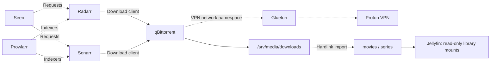

# Media Stack Overview

## Purpose

The HomeLAB media stack automates movie and TV series discovery, downloading, organization, seeding, and playback.

Survey date: **2026-11-13**. Container state, published ports and selected network/mount metadata were inspected. Application integrations were not exercised during the survey.

---

## Architecture

Seerr provides request management ahead of Radarr and Sonarr. It was running on port `5055`; a complete request-to-playback test remains outstanding.



Dashed edges describe the documented application workflow; they were not functionally retested. Prowlarr manages indexer connections, while Radarr and Sonarr handle their respective import workflows. The current filesystem mappings are listed below.

---

## Components

| Component | Responsibility |
|---|---|
| Seerr | Request management |
| Prowlarr | Central indexer management |
| Radarr | Movie automation |
| Sonarr | TV series automation |
| qBittorrent | Downloading and seeding |
| Gluetun | Proton VPN network gateway |
| qbit-port-sync | Dynamic Proton port synchronization |
| Jellyfin | Media library and playback |

---

## Storage

The inspected runtime mounts are:

| Container | Host path | Container path | Access |
|---|---|---|---|
| qBittorrent, Radarr, Sonarr | `/srv/media` | `/data` | Read/write |
| Jellyfin | `/srv/media/movies` | `/media/movies` | Read-only |
| Jellyfin | `/srv/media/series` | `/media/series` | Read-only |
| Seerr | `/srv/homelab/appdata/seerr` | `/app/config` | Read/write |

The download/import applications share this mapping:

```text
/srv/media -> /data
```

Relevant directories:

```text
/data/downloads
/data/movies
/data/series
```

The shared `/data` filesystem layout allows Radarr and Sonarr to import completed downloads using hardlinks where possible.

The media filesystem is mounted at `/srv/media`, separately from the root filesystem, and an `fstab` entry exists for that target. Behavior with a missing disk was not tested. The survey did not recheck a current file pair's device/inode identity; [hardlinks.md](hardlinks.md) records earlier test evidence.

---

## VPN Design

The media stack is configured to route qBittorrent torrent traffic through Proton VPN.

Radarr, Sonarr, Prowlarr and Jellyfin remain on the normal HomeLAB network.

qBittorrent shares the Gluetun network namespace.

The `qbit-port-sync` sidecar implements automatic port synchronization through qBittorrent's API. The functional outcome was not retested during this survey; see the [VPN source and limitations](vpn.md).

---

## Current Status

Observed on 2026-11-13:

- Jellyfin
- qBittorrent
- Gluetun
- qbit-port-sync
- Radarr
- Sonarr
- Prowlarr
- Seerr

All six media application roots returned HTTP responses from the Pi: Jellyfin `302`, qBittorrent `200`, Radarr `302`, Sonarr `302`, Prowlarr `302`, Seerr `307`. Redirects were not followed; these results establish endpoint reachability, not authenticated application or integration behavior.

VPN exit routing, forwarded-port synchronization, hardlink imports, tracker integration and remote media access were not retested. The existing [learning log](../learning-log.md) and service notes describe earlier deployment work.

Planned:

- automated backups
- expanded monitoring

Sentinel's timer and a permitted VPN-stack recovery helper were observed. Their existence does not establish correct recovery behavior; see the [Sentinel overview](../monitoring/sentinel-overview.md). DNS filtering and automated hardware migration are deferred.

---

## Design Principles

- One responsibility per service
- Persistent configuration is separated from media
- Shared filesystem layout enables hardlinks
- Secrets are excluded from Git
- Torrent traffic is isolated behind VPN
- The rest of the media stack stays on the normal network
- Documentation follows the deployed system
